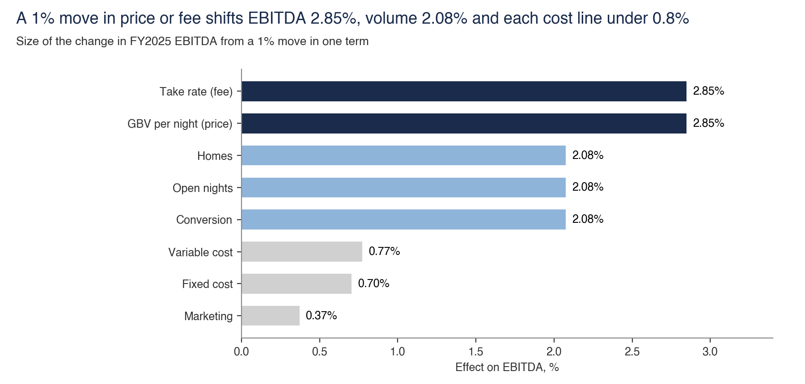

# Airbnb case study: the evidence, term by term

**EBITDA = booked nights × contribution per night − marketing − fixed cost**

**Booked nights = homes × open nights × conversion**

FY2025: $4,297m = 533m × [($171.24 × 13.41%) − $6.23] − $1,595m − $3,026m

Contents: [claims](#the-three-claims) · [ranking](#terms-ranked-by-a-1-move) · [what moved against me](#three-results-that-moved-against-me) · [every figure](#every-figure-weakest-first) · [the walk](#the-walk-through-the-equation) · [run it](#run-it)

## The three claims

Every figure below carries one of these tags.

- **Claim 1. Hosts fund the homes and stay at Airbnb's fee.** Weakened. Low overlap holds as a Seattle band, tasks done outright fell from 21 to 8, and take rate moved from 13.57% to 13.19%.
- **Claim 2. Repeat guests and unpaid demand fill nights without rising marketing.** Weakened. The review coefficient fell from 0.346 to 0.029, selection explains 73% to 87% of the return ladder, and the return lead over Expedia, Vrbo and Hilton holds.
- **Claim 3. Added nights reach EBITDA on a light cost base.** Holding. The equation closes and nights supplied 74% of the EBITDA rise from 2022 to 2025, though Booking kept $11.51 of clean income per added night against Airbnb's $5.18.

## Terms ranked by a 1% move

Price and fee matter most, volume comes second, and each cost line moves EBITDA by under 0.8%.

| Rank | Term | FY2025 EBITDA effect | Year to Q3 2026 |
|---|---|---|---|
| 1 | Take rate (fee) | 2.85% | 2.75% |
| 1 | GBV per night (price) | 2.85% | 2.75% |
| 3 | Homes, open nights or conversion | 2.08% | 2.03% |
| 4 | Variable cost per night | 0.77% | 0.72% |
| 5 | Fixed cost | 0.70% | 0.64% |
| 6 | Marketing | 0.37% | 0.38% |

Homes, open nights and conversion multiply into booked nights, so a 1% move in any one of them has the same effect. GBV per night reads 2.42% after 2% payment cost. These are sensitivities from [ranking.py](ebitda/ranking/ranking.py), and they say nothing on which term will move.



## Three results that moved against me

**The conversion coefficient fell from 0.346 to 0.029.** Prior reviews stand in for past demand. Once 2025 reviews absorb it on the same 89,546 homes, the coefficient falls to 0.029 (0.019 to 0.040) and the implied gap to Booking.com falls from 2.1x to 1.07x (1.04x to 1.09x). A split-sample instrument gives -0.101. The effect of review depth on bookings stays unproven, and review content holds up better. [conversion](conversion/)

**16 of 54 role ratings failed an outside check.** The task map was my own coding, and the bias ran towards Airbnb. Tasks done outright fell from 21 to 8, tasks shared rose from 16 to 30, and the total done or shared stays near 38. [homes](homes/)

**Seattle overlap reads as a band from 10.5% to 17.9%.** The point figure is 12.5%, or 568 of 4,538 licensed homes. The candidate match rungs failed the hidden-key test: coordinates found 33.4% to 67.4% of known pairs and picked a home for 85.8% to 99.7% of rows with no twin. Only licence keys count, so the unkeyed rows widen the figure into a band, and the 200 planned hand checks of the key match were never done. Counting 15 further rows whose licence Airbnb's file lacks gives the 18.2% printed in the footnote of the note. [homes](homes/)

## Every figure, weakest first

**Dropped** means the figure failed its test or is too thin to quote. **Weakened** means it stands only with its stated limit. **Holding** means it reran and no test moved it. Claim is the tag above. Figures are checked against version 15 of the note, dated 6 November 2026, and the test behind each row is in [figures.csv](figures.csv).

<!-- table start -->
| Status | Figure | Claim | Term | Sample | Interval | Note prints |
|---|---|---|---|---|---|---|
| **dropped** | Tasks Airbnb does outright, as filed | 1 | [homes](homes/) | 54 tasks, own coding | None | Removed from the note |
| **dropped** | Tasks Airbnb shares, as filed | 1 | [homes](homes/) | 54 tasks, own coding | None | Removed from the note |
| **dropped** | Coordinate matches counted as shared homes | 1 | [homes](homes/) | 1,382 known pairs, San Diego and Seattle | 33.4% to 67.4% of pairs found | Not counted |
| **dropped** | Viewable, ids first seen June 2025 | 1 | [homes](homes/) | 4 live of 19 sampled ids | 49.2% to 68.5% | Not in the note |
| **dropped** | Viewable, ids first seen August 2025 | 1 | [homes](homes/) | 3 live of 18 sampled ids | 56.8% to 72.1% | Not in the note |
| **dropped** | Viewable, ids first seen January 2026 | 1 | [homes](homes/) | 0 live of 16 sampled ids | 65.6% to 72.3% | Not in the note |
| **dropped** | Viewable, ids first seen May 2026 | 1 | [homes](homes/) | 0 live of 3 sampled ids | 78.0% to 90.4% | Not in the note |
| **dropped** | Review coefficient read as an effect on bookings | 2 | [conversion](conversion/) | 89,546 homes, ten cities | 0.335 to 0.356 | 0.34 |
| **dropped** | Conversion gap against Booking.com, 2.1x | 2 | [conversion](conversion/) | Review ratio 90.3 to 9.7 | None | 2.1x |
| **dropped** | Conversion gap against Vrbo, 1.2x | 2 | [conversion](conversion/) | Review ratio 61.7 to 38.3 | None | 1.2x |
| **dropped** | Same-guest gap of 143, 110 and 101 days | 2 | [conversion](conversion/) | 191,520 guests | None | Removed from the note |
| **weakened** | Seattle homes also on Booking.com | 1 | [homes](homes/) | 4,538 licensed whole homes, 773 Booking.com rows | Bounds 10.5% to 18.2% | 12.5% |
| **weakened** | Seattle homes absent from Booking.com | 1 | [homes](homes/) | 4,538 licensed whole homes | Bounds 81.8% to 89.5% | 87.5% |
| **weakened** | Seattle homes on neither rival | 1 | [homes](homes/) | 4,538 homes, Vrbo pull reached 35.8% | About 68.0% to 80.5% | Up to 80.5% |
| **weakened** | Airbnb nights on those homes | 1 | [homes](homes/) | Nights estimated from reviews | About 73.1% to 82.6% | Up to 82.6% |
| **weakened** | San Diego homes on neither rival | 1 | [homes](homes/) | 7,377 homes, Vrbo pull reached 10.4% | About 58.1% to 90.6% | Not in the note |
| **weakened** | Lisbon Booking.com rows found on Airbnb | 1 | [homes](homes/) | 175 of 237 keyed rows, 4.9% of reported rows | 68.0% to 73.8% under reweighting | Not in the note |
| **weakened** | Hawaii Booking.com rows found on Airbnb | 1 | [homes](homes/) | 218 of 314 keyed rows, 3.8% of reported rows | 67.7% to 74.1% under reweighting | Not in the note |
| **weakened** | Hawaii Vrbo rows found on Airbnb | 1 | [homes](homes/) | 238 of 391 keyed rows, 4.5% of reported homes | 60.5% to 61.8% under reweighting | Not in the note |
| **weakened** | Lisbon Vrbo rows found on Airbnb | 1 | [homes](homes/) | 236 of 316 keyed rows, 9.9% of reported homes | 74.7% to 76.4% under reweighting | Not in the note |
| **weakened** | Ids no longer viewable, millions | 1 | [homes](homes/) | 400 sampled ids applied to 9.22m absent ids | 7.66m to 8.27m | Not in the note |
| **weakened** | Viewable, ids dated before 2023 | 1 | [homes](homes/) | 32 live of 204 sampled ids | 41.7% to 48.3% | Not in the note |
| **weakened** | Viewable, ids dated 2023 | 1 | [homes](homes/) | 10 live of 82 sampled ids | 35.2% to 45.1% | Not in the note |
| **weakened** | Viewable, ids dated 2024 | 1 | [homes](homes/) | 7 live of 68 sampled ids | 42.1% to 51.1% | Not in the note |
| **weakened** | Viewable, ids dated 2025 and 2026 | 1 | [homes](homes/) | 4 live of 46 sampled ids | 73.7% to 78.3% | Not in the note |
| **weakened** | Viewable, ids first seen March 2023 | 1 | [homes](homes/) | 26 live of 170 sampled ids | 39.1% to 46.5% | Not in the note |
| **weakened** | Viewable, ids first seen November 2023 | 1 | [homes](homes/) | 7 live of 57 sampled ids | 35.5% to 47.3% | Not in the note |
| **weakened** | Viewable, ids first seen May 2024 | 1 | [homes](homes/) | 4 live of 40 sampled ids | 35.2% to 48.1% | Not in the note |
| **weakened** | Viewable, ids first seen November 2024 | 1 | [homes](homes/) | 4 live of 44 sampled ids | 38.3% to 49.6% | Not in the note |
| **weakened** | Viewable, ids first seen February 2025 | 1 | [homes](homes/) | 5 live of 33 sampled ids | 42.8% to 57.7% | Not in the note |
| **weakened** | Yearly loss, ids dated 2023 | 1 | [homes](homes/) | 82 sampled ids, age 3.35 years | 21% to 27% | Not in the note |
| **weakened** | First-time owners, share of new homes in 2025 | 1 | [homes](homes/) | 46,733 homes | None | 49.1% |
| **weakened** | Seattle ceiling: unkeyed and unread rows counted | 1 | [homes](homes/) | 811 of 4,538 homes | Upper bound of the band | Footnote prints 18.2% |
| **weakened** | Seattle widest bound: adds 15 rows with a key Airbnb lacks | 1 | [homes](homes/) | 826 of 4,538 homes | Upper bound | 18.2% |
| **weakened** | Host protection up to $3m, against $1m on Booking in the US | 1 | [homes](homes/) | Airbnb 10-K for the $3m | Cited | $3m, $1m |
| **weakened** | Airbnb share of reviews on homes matched to Booking.com | 2 | [conversion](conversion/) | 693 homes, three markets | None | 90.3% |
| **weakened** | Airbnb last 12 months above Booking.com lifetime reviews | 2 | [conversion](conversion/) | 810 homes, four markets | None | 65.8% |
| **weakened** | Airbnb ahead of Vrbo on the same home | 2 | [conversion](conversion/) | 748 homes, four markets | None | 68.9% |
| **weakened** | Airbnb ahead of Booking.com on the same home | 2 | [conversion](conversion/) | 810 homes, four markets | None | 85.6% |
| **weakened** | New homes under three Booking.com reviews | 2 | [conversion](conversion/) | 140 same homes under a year old | None | 69.3% |
| **weakened** | 24-month return at stay 5 | 2 | [conversion](conversion/) | 41,644 fifth stays, 7.47m stays in all | 60.27% to 61.21% | 60.7% |
| **weakened** | 24-month return at stay 1 | 2 | [conversion](conversion/) | 5.94m first stays | 14.90% to 14.96% | 14.9% |
| **weakened** | Booking.com active after three quarters | 2 | [conversion](conversion/) | Card panel, ratio only | None | 7.3% |
| **weakened** | New share of actives, Airbnb | 2 | [conversion](conversion/) | Card panel, ratio only | None | 18.6% |
| **weakened** | Airbnb over Vrbo spend per customer, first month | 2 | [conversion](conversion/) | Card panel, ratio only | None | Printed as dollars |
| **weakened** | Airbnb over Vrbo spend per customer, months 1 to 6 after | 2 | [conversion](conversion/) | Card panel, ratio only | None | Printed as dollars |
| **weakened** | Fall in customers first seen before July 2024 | 2 | [conversion](conversion/) | Card panel, ratio only | None | Not in the note |
| **weakened** | Seattle homes with no Google hotel within 700 m | 2 | [conversion](conversion/) | 4,549 homes | None | Not in the note |
| **weakened** | Lisbon homes with no Google hotel within 700 m | 2 | [conversion](conversion/) | 17,075 homes | None | Not in the note |
| **weakened** | R-squared gain from Google location, Maui | 2 | [conversion](conversion/) | 7,550 homes | Seattle 5.8, San Diego 6.1, Lisbon 4.3 | Not in the note |
| **weakened** | Held-out gain over neighbourhood, Maui | 2 | [conversion](conversion/) | 7,550 homes | Other markets -0.2 to 0.0 | Not in the note |
| **weakened** | Lisbon two-bedroom home over two hotel rooms | 2 | [conversion](conversion/) | 210 homes, 12 to 15 March 2027 | None | 0.85x |
| **weakened** | Lisbon three-bedroom home over three hotel rooms | 2 | [conversion](conversion/) | 49 homes | None | 0.66x |
| **weakened** | 24-month return at stay 2 | 2 | [conversion](conversion/) | 1.05m second stays | 27.30% to 27.48% | 27.4% |
| **weakened** | 24-month return at stay 3 | 2 | [conversion](conversion/) | 277,355 third stays | 39.34% to 39.70% | 39.5% |
| **weakened** | 24-month return at stay 4 | 2 | [conversion](conversion/) | 96,132 fourth stays | 51.06% to 51.70% | 51.4% |
| **weakened** | New share of actives, Booking.com | 2 | [conversion](conversion/) | Card panel, ratio only | None | 42.1% |
| **weakened** | Lisbon home for four over two rooms in the cheapest quarter of hotels | 2 | [conversion](conversion/) | 273 homes | None | 1.08x |
| **weakened** | Larger homes, 20.1% of listings and 30.3% of revenue | 2 | [conversion](conversion/) | Median of 110 regions | None | 20.1%, 30.3% |
| **weakened** | Price per guest of larger homes | 2 | [conversion](conversion/) | Median of 110 regions | None | 0.73x to 0.77x |
| **weakened** | Activity of guests first reviewing in 2016 | 2 | [conversion](conversion/) | Reviewer accounts | None | 3.6%, 1.1%, 3.7% |
| **weakened** | Return percentile across brands | 2 | [conversion](conversion/) | Card panel, ratio only | None | 83, 63, 64, 53, 34 |
| **weakened** | Vrbo reservations per 100 on Airbnb | 1 | [contribution_per_night](contribution_per_night/) | US managed homes, Q2 2026 | None | 39.2 |
| **weakened** | Direct reservations per 100 on Airbnb | 1 | [contribution_per_night](contribution_per_night/) | US managed homes, Q2 2026 | None | 41.2 |
| **weakened** | All other channels per 100 on Airbnb, a ceiling for Booking.com | 1 | [contribution_per_night](contribution_per_night/) | US managed homes, Q2 2026 | None | 15.7 max |
| **weakened** | Reviews fall 0.03% on single-owner homes and 0.70% on hotel rooms for a 1% price rise | 1 | [contribution_per_night](contribution_per_night/) | 2 km cells | None | 0.03%, 0.70% |
| **weakened** | First-year take per $100, Booking | 2 | [marketing](marketing/) | Net take and panel later-spend ratio | None | $13.88 |
| **holding** | Take rate, FY2025 | 1 | [ebitda](ebitda/) | Airbnb 10-K | Reported | 13.41% |
| **holding** | EBITDA effect of a 1% move in GBV per night | 1 | [ebitda](ebitda/) | FY2025 | Identity | Not in the note |
| **holding** | Brand and performance marketing, $m | 2 | [ebitda](ebitda/) | Airbnb 10-K | Reported | $1,595m |
| **holding** | EBITDA effect of a 1% move in marketing | 2 | [ebitda](ebitda/) | FY2025 | Identity | Not in the note |
| **holding** | FY2025 Adjusted EBITDA from the equation, $m | 3 | [ebitda](ebitda/) | Airbnb 10-K | Identity | $4,297m |
| **holding** | EBITDA per night | 3 | [ebitda](ebitda/) | 533m nights and seats | Identity | $8.06 |
| **holding** | EBITDA change, 2022 to 2025, $m | 3 | [ebitda](ebitda/) | Airbnb filings | Identity | +$1,394m |
| **holding** | Revenue-per-night term of the bridge, $m | 3 | [ebitda](ebitda/) | Airbnb filings | Identity | +$866m |
| **holding** | Nights share of the increase | 3 | [ebitda](ebitda/) | Airbnb filings | Identity | 74% |
| **holding** | EBITDA effect of a 1% move in take rate | 3 | [ebitda](ebitda/) | FY2025 | Identity | Not in the note |
| **holding** | EBITDA effect of a 1% move in nights | 3 | [ebitda](ebitda/) | FY2025 | Identity | Not in the note |
| **holding** | Revenue kept after cost of revenue and marketing | 3 | [ebitda](ebitda/) | Eight companies with a cost line, FY2025 | None | 61.8% |
| **holding** | Case companies on the Compustat frame | 3 | [ebitda](ebitda/) | 153 company-years, 51 tickers | None | Nine models |
| **holding** | Nights and seats booked, FY2025, millions | 3 | [ebitda](ebitda/) | Airbnb 10-K | Reported | 533m |
| **holding** | GBV per night, FY2025 | 3 | [ebitda](ebitda/) | Airbnb 10-K | Reported | $171.24 |
| **holding** | Variable cost per night | 3 | [ebitda](ebitda/) | Airbnb 10-K | Reported | $6.23 |
| **holding** | Fixed cost, $m | 3 | [ebitda](ebitda/) | Airbnb 10-K | Identity | $3,026m |
| **holding** | Contribution per night | 3 | [ebitda](ebitda/) | Airbnb 10-K | Identity | $16.73 |
| **holding** | Contribution after marketing | 3 | [ebitda](ebitda/) | Airbnb 10-K | Identity | $13.74 |
| **holding** | Nights term of the bridge, $m | 3 | [ebitda](ebitda/) | Airbnb filings | Identity | +$1,027m |
| **holding** | EBITDA effect of a 1% move in variable cost | 3 | [ebitda](ebitda/) | FY2025 | Identity | Not in the note |
| **holding** | EBITDA effect of a 1% move in fixed cost | 3 | [ebitda](ebitda/) | FY2025 | Identity | Not in the note |
| **holding** | Nights, 2023 to 2025 | 2 | [booked_nights](booked_nights/) | Airbnb filings | Guests 17% to 26% | +18.9% |
| **holding** | Guests, 2023 to 2025 | 2 | [booked_nights](booked_nights/) | Dated reviewer accounts | 17% to 26% | +22.0% |
| **holding** | New-account points of 2025 bookings growth | 2 | [booked_nights](booked_nights/) | Reviewer account layers | None | 9.2 of 10.1 |
| **holding** | Trips per guest, 2023 to 2025 | 2 | [booked_nights](booked_nights/) | Dated reviewer accounts | -1.9% to +5.3% | +1.1% |
| **holding** | Nights per trip, 2023 to 2025 | 2 | [booked_nights](booked_nights/) | Filings and reviewer accounts | -2.9% to -4.2% | -3.6% |
| **holding** | Listing ids in the union of ten snapshots | 1 | [homes](homes/) | Ten sitemap and Wayback snapshots | Count | Not in the note |
| **holding** | Ids in the November 2026 sitemap | 1 | [homes](homes/) | All 139 sitemap files | Count | Not in the note |
| **holding** | Viewable listings, millions | 1 | [homes](homes/) | 1,710,831 census listings, 499 fetched ids | 10.34m to 10.60m | Not in the note |
| **holding** | Out-of-sitemap ids still live | 1 | [homes](homes/) | 440 of 499 ids | 85.0% to 90.7% | Not in the note |
| **holding** | Absent ids returning a withdrawn page | 1 | [homes](homes/) | 347 of 400 ids | 83.1% to 89.7% | Not in the note |
| **holding** | Listings gone in nine months, ten cities | 1 | [homes](homes/) | 95,202 of 392,070 listings | Census | Not in the note |
| **holding** | Leavers whose host has no listing left in the city | 1 | [homes](homes/) | 95,202 leavers | Census | Not in the note |
| **holding** | Seattle floor, one home per Booking.com row | 1 | [homes](homes/) | 476 of 4,538 homes | Lower bound | 10.5% |
| **holding** | Keyed Booking.com rows also on Airbnb | 1 | [homes](homes/) | 558 keyed rows | 97.3% to 97.6% under reweighting | 543 of 558 |
| **holding** | Keyed Vrbo rows also on Airbnb | 1 | [homes](homes/) | 364 of 399 keyed rows | 90.2% to 91.3% under reweighting | 91.2% |
| **holding** | San Diego Booking.com rows also on Airbnb | 1 | [homes](homes/) | 298 of 313 keyed rows | 95.1% to 95.2% under reweighting | 95.2% |
| **holding** | San Diego Vrbo rows also on Airbnb | 1 | [homes](homes/) | 247 of 297 keyed rows | 83.0% to 83.9% under reweighting | 83.2% |
| **holding** | Tasks Airbnb does outright, after checks | 1 | [homes](homes/) | 54 tasks | None | Part of "about 38" |
| **holding** | Tasks Airbnb does or shares, after checks | 1 | [homes](homes/) | 54 tasks | None | About 38 of 54 |
| **holding** | Co-Host Network near 100,000 listings in four months | 1 | [homes](homes/) | Q4 2024 earnings call | Cited | Nearly 100,000 |
| **holding** | Hosts with 1 to 5 homes open up to 240 days, on Booking.com | 1 | [open_nights](open_nights/) | 44.2% of 4,538 homes | 4.6% to 6.6% | 5.5% |
| **holding** | Hosts with 6 or more homes open over 240 days, on Booking.com | 1 | [open_nights](open_nights/) | 13.0% of 4,538 homes | 33.3% to 41.1% | 37.1% |
| **holding** | Sum of the four groups | 1 | [open_nights](open_nights/) | 4,538 homes | None | 12.5% |
| **holding** | Open nights, shared against not shared, same host, Seattle | 1 | [open_nights](open_nights/) | 65 hosts, 871 homes | 8.1 to 46.9, p=0.006 | +27.5 |
| **holding** | Airbnb nights, same test, Seattle | 1 | [open_nights](open_nights/) | 65 hosts, 871 homes | -9.6 to 14.2, p=0.71 | +2.3 |
| **holding** | Open nights, same test, San Diego | 1 | [open_nights](open_nights/) | 119 hosts, 1,982 homes | 10.8 to 29.8, p<0.001 | +20.3 |
| **holding** | Airbnb nights, same test, San Diego | 1 | [open_nights](open_nights/) | 119 hosts, 1,982 homes | -11.9 to 2.6, p=0.21 | -4.6 |
| **holding** | Hosts with 1 to 5 homes open over 240 days, on Booking.com | 1 | [open_nights](open_nights/) | 30.4% of 4,538 homes | 8.1% to 11.1% | 9.5% |
| **holding** | Hosts with 6 or more homes open up to 240 days, on Booking.com | 1 | [open_nights](open_nights/) | 12.4% of 4,538 homes | 16.2% to 22.7% | 19.2% |
| **holding** | Median months to reach 25 reviews | 1 | [conversion](conversion/) | Survivors only | None | 37.6 |
| **holding** | Same-host price premium at 50 or more reviews | 1 | [conversion](conversion/) | 54,820 homes | None | 4.8% |
| **holding** | Review coefficient with past demand absorbed | 2 | [conversion](conversion/) | 89,546 homes | 0.019 to 0.040 | 0.029 |
| **holding** | Conversion gap against Booking.com, past demand held equal | 2 | [conversion](conversion/) | 89,546 homes, review ratio 90.3 to 9.7 | 1.04x to 1.09x | 1.07x |
| **holding** | Bad stays, past demand absorbed | 2 | [conversion](conversion/) | 89,546 homes | -0.039 to -0.028 | -0.034 |
| **holding** | Prior reviews on blocked nights, past demand absorbed | 2 | [conversion](conversion/) | 89,546 homes | 0.71 to 1.24 | Not in the note |
| **holding** | Top record-score fifth, booked share of open nights | 2 | [conversion](conversion/) | 18,060 homes | None | 51.8% |
| **holding** | Lowest record-score fifth, booked share of open nights | 2 | [conversion](conversion/) | 18,213 homes | None | 34.0% |
| **holding** | Nine-month exit, below 4.5 stars | 2 | [conversion](conversion/) | 14,674 listings | Census | 25.3% |
| **holding** | Nine-month exit, 4.8 to 4.9 stars | 2 | [conversion](conversion/) | 30,453 listings | Census | 10.1% |
| **holding** | Repeat stays with another host | 2 | [conversion](conversion/) | 1.57m repeat stays | None | 92.0% |
| **holding** | Repeat stays in another city | 2 | [conversion](conversion/) | 1.57m repeat stays | None | 47.7% |
| **holding** | New group active after three quarters, Airbnb | 2 | [conversion](conversion/) | Card panel, ratio only | None | 13.3% |
| **holding** | New group active after three quarters, Expedia | 2 | [conversion](conversion/) | Card panel, ratio only | None | 7.9% |
| **holding** | New group active after three quarters, Vrbo | 2 | [conversion](conversion/) | Card panel, ratio only | None | 6.2% |
| **holding** | Active months per 100 customers, Airbnb | 2 | [conversion](conversion/) | Card panel, ratio only | None | 69.5 |
| **holding** | Airbnb active share over Vrbo, lowest age | 2 | [conversion](conversion/) | 54 matched groups | 2.53x to 3.11x by age | 2.53x |
| **holding** | Airbnb share of reviews on homes matched to Vrbo | 2 | [conversion](conversion/) | 575 homes, three markets | None | 61.7% |
| **holding** | R-squared of the original regression | 2 | [conversion](conversion/) | 89,546 homes | None | 0.18 |
| **holding** | New group active after three quarters, Hilton | 2 | [conversion](conversion/) | Card panel, ratio only | None | 4.4% |
| **holding** | Active months per 100 customers, Expedia | 2 | [conversion](conversion/) | Card panel, ratio only | None | 32.2 |
| **holding** | Active months per 100 customers, Vrbo | 2 | [conversion](conversion/) | Card panel, ratio only | None | 20.8 |
| **holding** | Later spend as a share of month one, Airbnb | 2 | [conversion](conversion/) | Card panel, ratio only | None | 51.5% |
| **holding** | Later spend as a share of month one, Vrbo | 2 | [conversion](conversion/) | Card panel, ratio only | None | 26.7% |
| **holding** | Break-even night loss for a point of take rate | 1 | [contribution_per_night](contribution_per_night/) | FY2025 filings | 9.2% to 11.4% across periods and marketing treatments | 9.3% |
| **holding** | Take rate, FY2024 | 1 | [contribution_per_night](contribution_per_night/) | Airbnb filings | Reported | 13.57% |
| **holding** | Take rate, year to Q2 2026 | 1 | [contribution_per_night](contribution_per_night/) | Airbnb filings | Reported | 13.19% |
| **holding** | Bookings to replace on Vrbo | 1 | [contribution_per_night](contribution_per_night/) | A 4.1-night stay, $948 host take | 90.2% at the earlier 8% Vrbo fee | 95.2% |
| **holding** | Bookings to replace on Booking.com | 1 | [contribution_per_night](contribution_per_night/) | A 4.1-night stay, $948 host take | None | 99.3% |
| **holding** | Bookings to replace on an own site | 1 | [contribution_per_night](contribution_per_night/) | A 4.1-night stay, $948 host take | None | 84.5% |
| **holding** | A point of take rate, per night | 1 | [contribution_per_night](contribution_per_night/) | FY2025 | Identity | $1.71 |
| **holding** | Fee saved per stay on Vrbo | 1 | [contribution_per_night](contribution_per_night/) | $1,378 stay value | None | $48 |
| **holding** | Fee saved per stay on Booking.com | 1 | [contribution_per_night](contribution_per_night/) | $1,378 stay value | None | $7 |
| **holding** | Fee saved per stay on an own site | 1 | [contribution_per_night](contribution_per_night/) | $1,378 stay value | None | $174 |
| **holding** | Sonder operating loss before special lines | 3 | [contribution_per_night](contribution_per_night/) | Sonder 10-K, FY2024 | $22.06 to $24.07 on estimated bookings | $26.47 per $100 of revenue |
| **holding** | Vacasa sales and marketing per $100 of GBV | 3 | [contribution_per_night](contribution_per_night/) | Vacasa 10-K, FY2024 | None | $8.49 |
| **holding** | Airbnb sales and marketing per $100 of GBV | 3 | [contribution_per_night](contribution_per_night/) | Airbnb 10-K, FY2024 | None | $2.63 |
| **holding** | Marketing per $100 of bookings, Airbnb | 2 | [marketing](marketing/) | Airbnb filings, FY2025 | None | $1.75 |
| **holding** | Marketing per $100 of bookings, Booking | 2 | [marketing](marketing/) | Booking filings, FY2025 | None | $4.40 |
| **holding** | Marketing per $100 of bookings, Expedia | 2 | [marketing](marketing/) | Expedia filings, FY2025 | None | $6.15 |
| **holding** | Net take, Airbnb | 2 | [marketing](marketing/) | Airbnb filings, FY2025 | None | 11.66% |
| **holding** | Search share of visits, Airbnb | 2 | [marketing](marketing/) | Semrush estimate, web visits | None | 17% |
| **holding** | Airbnb ads selling a trip type or the brand | 2 | [marketing](marketing/) | 43 hand-coded ads | None | 36 of 43 |
| **holding** | Vrbo ads built on a property template | 2 | [marketing](marketing/) | 33 hand-coded ads | None | 30 of 33 |
| **holding** | Net take, Booking | 2 | [marketing](marketing/) | Booking filings, FY2025 | None | 10.06% |
| **holding** | Net take, Expedia | 2 | [marketing](marketing/) | Expedia filings, FY2025 | None | 6.17% |
| **holding** | First-year take per $100, Airbnb | 2 | [marketing](marketing/) | Net take and panel later-spend ratio | None | $20.17 |
| **holding** | First-year take per $100, Expedia | 2 | [marketing](marketing/) | Net take and panel later-spend ratio | None | $8.95 |
| **holding** | Search share of visits, Booking | 2 | [marketing](marketing/) | Semrush estimate, web visits | None | 46% |
| **holding** | Search share of visits, Expedia | 2 | [marketing](marketing/) | Semrush estimate, web visits | None | 49% |
| **holding** | About 90% of traffic direct or unpaid | 2 | [marketing](marketing/) | Management estimate | Cited | About 90% |
| **holding** | Marketing per $100 of added bookings, Airbnb | 2 | [fixed_cost](fixed_cost/) | Airbnb filings | None | Removed from the note |
| **holding** | Left per $100 of added bookings, Airbnb | 2 | [fixed_cost](fixed_cost/) | Airbnb filings | None | $11.68 |
| **holding** | Marketing per added night, H1 2026 | 2 | [fixed_cost](fixed_cost/) | Airbnb 10-Q | None | $9.89 |
| **holding** | Marketing per added night, FY2022 to FY2025 | 2 | [fixed_cost](fixed_cost/) | Airbnb filings | None | $4.06 |
| **holding** | Revenue per added night, FY2022 to FY2025 | 3 | [fixed_cost](fixed_cost/) | Airbnb filings | None | $27.58 |
| **holding** | Left after variable cost and marketing | 3 | [fixed_cost](fixed_cost/) | Airbnb filings | None | $17.45 |
| **holding** | Clean income per added night, Airbnb | 3 | [fixed_cost](fixed_cost/) | Airbnb filings | None | $5.18 |
| **holding** | Clean income per added night, Booking | 3 | [fixed_cost](fixed_cost/) | Booking filings | None | Not in the note |
| **holding** | Fixed cost growth a year | 3 | [fixed_cost](fixed_cost/) | Airbnb filings | None | 15.0% |
| **holding** | Break-even nights, millions | 3 | [fixed_cost](fixed_cost/) | Airbnb filings | None | 220m |
| **holding** | Nights growth above the fixed-cost hurdle, points | 3 | [fixed_cost](fixed_cost/) | Airbnb filings | None | 4.4 |
| **holding** | Added revenue kept after marketing, FY2022 to FY2025 | 3 | [fixed_cost](fixed_cost/) | Airbnb filings | None | 63% |
| **holding** | Added revenue kept after marketing, H1 2026 | 3 | [fixed_cost](fixed_cost/) | Airbnb 10-Q | None | 49% |
| **holding** | Fixed cost share of contribution after marketing | 3 | [fixed_cost](fixed_cost/) | Airbnb filings | None | 41.3% |
| **holding** | Nights growth a year, FY2022 to FY2025 | 3 | [fixed_cost](fixed_cost/) | Airbnb filings | None | 10.6% |
| **holding** | Nights growth needed to hold EBITDA flat | 3 | [fixed_cost](fixed_cost/) | Airbnb filings | None | 6.2% |
| **holding** | Left per $100 of added bookings, Booking | 3 | [fixed_cost](fixed_cost/) | Booking filings | None | $11.77 |
<!-- table end -->

## The walk through the equation

### EBITDA, $4,297m in FY2025

- **The term.** Nights times contribution per night, less marketing and fixed cost, or $8.06 a night.
- **What moves it.** The ranking above.
- **Measured.** The identity closes to zero on filed lines. EBITDA rose $1,394m from 2022 to 2025, and nights supplied 74% of it.
- **How hard to break.** An identity cannot fail, so the test sits in the terms. It leaves out stock pay, and FY2022 is a recovery base. Airbnb kept 61.8% of revenue after cost of revenue and marketing, against 52.4% at Pinterest, the next of the companies with a cost line. [ebitda](ebitda/)

### Booked nights, 533m

- **The term.** Homes × open nights × conversion. The filings give the total.
- **What moves it.** Guests, trips per guest and nights per trip, which split the 2023 to 2025 rise as +18.9% = +22.0% × +1.1% × -3.6%.
- **Measured.** New accounts supplied 9.2 of the 10.1 points of 2025 bookings growth, and existing accounts added 7.0, 2.0 and 0.8 points across 2023 to 2025.
- **How hard to break.** The product holds. The guest term is modelled from reviewer accounts, with a range of 17% to 26%. [booked_nights](booked_nights/)

### Homes

- **The term.** Listings that hosts fund and keep on the site.
- **What moves it.** Host effort, protection, regulation and rival sites.
- **Measured.** 16,150,130 ids across ten sitemap and Wayback snapshots, about 10.47m viewable (10.34m to 10.60m), and 87.5% of licensed Seattle homes absent from Booking.com.
- **How hard to break.** Moderately. Counts hold. 24.3% of listings left ten cities in nine months, and nothing shows where they went. The survival cells rest on 400 sampled ids and four are too thin to quote. Lisbon and Hawaii rival rates are directional, and the 49.1% first-time owner figure has lost its build script. [homes](homes/)

### Open nights

- **The term.** The days a home offers for sale.
- **What moves it.** Host size and a second site.
- **Measured.** Overlap runs from 5.5% for small hosts with fuller calendars to 37.1% for large hosts with open ones, and the four groups sum exactly to 12.5%. Under the same host, shared homes held 27.5 more open nights in Seattle (8.1 to 46.9) and 20.3 in San Diego (10.8 to 29.8).
- **How hard to break.** The sum is exact and the direction is open, because a home sold on two sites can hold more open days for that reason alone. Airbnb nights moved +2.3 (p=0.71) and -4.6 (p=0.21). [open_nights](open_nights/)

### Conversion

- **The term.** The share of open nights that sell.
- **What moves it.** Reviews, price against hotels and repeat guests.
- **Measured.** The strongest review records booked 51.8% of open nights against 34.0% for the weakest. Bad stays lower bookings with past demand absorbed (-0.034, -0.039 to -0.028). Return runs from 14.9% at stay 1 to 60.7% at stay 5, and 13.3% of a new group stays active after three quarters against 7.9% at Expedia.
- **How hard to break.** This is the weakest term. Review depth failed, selection reproduces 87.1% of the ladder, and Booking.com is not comparable in the card panel. Review content and the return lead over Expedia, Vrbo and Hilton survive. [conversion](conversion/)

### Contribution per night, $16.73

- **The term.** GBV per night times take rate less variable cost: $171.24 × 13.41% − $6.23.
- **What moves it.** The fee, the price and who carries property cost.
- **Measured.** A point of take rate adds $1.71 a night and pays until nights fall 9.3%. A host would need to replace 95.2% of bookings on Vrbo, 99.3% on Booking.com and 84.5% on an own site. Sonder, which rented its homes, lost $26.47 per $100 of revenue.
- **How hard to break.** The break-even is an identity with no measured demand response, and take rate fell from 13.57% to 13.19% before reaching 13.32%. Delivered bookings of 39.2, 41.2 and at most 15.7 are income hosts already earn, so they cannot show recapture. [contribution_per_night](contribution_per_night/)

### Marketing, $1,595m

- **The term.** Brand and performance marketing, $1.75 per $100 of bookings against $4.40 at Booking and $6.15 at Expedia.
- **What moves it.** Direct traffic and repeat guests.
- **Measured.** Net take of 11.66% against 10.06% and 6.17%, and first-year take of $20.17 against $13.88 and $8.95.
- **How hard to break.** The levels hold and the direction is against me. Marketing per added night rose from $4.06 to $9.89 in H1 2026, and the net take lead over Booking narrowed from 1.86 to 1.60 points. Search share is a Semrush web estimate that misses app traffic. [marketing](marketing/)

### Fixed cost, $3,026m

- **The term.** The balance after variable cost, marketing and EBITDA.
- **What moves it.** Product development, overhead and new lines, spread over nights.
- **Measured.** Fixed cost grew 15.0% a year and absorbed 41.3% of contribution after marketing, so nights needed 6.2% a year against 10.6% delivered. Break-even is 220m nights.
- **How hard to break.** The hurdle holds. Each added night left $17.45 after marketing and $5.18 of clean income, against $11.51 at Booking, so the case rests on owned demand. [fixed_cost](fixed_cost/)

## Run it

```bash
pip install -r requirements.txt
```

```bash
python reproduce.py
```

`reproduce.py` runs every study from the committed tables, compares each figure with `figures.csv`, and fails if any file serves no figure. It needs no scraping, no API key and no licensed file. The regression reruns in full from neighbourhood-level moment tables, and the selection model refits from stay-by-tenure cells. Location is the exception, because Google cell counts stay out, so that script rebuilds the call totals and reads the regression results as market summaries.

## Kept out of this repo

| Source | Published here | Kept out |
|---|---|---|
| Inside Airbnb census | Aggregates and moment tables | Listing rows, ids, hosts, reviewers, coordinates |
| Sitemap and Wayback frame | Presence patterns and counts | The 16,150,130 ids |
| Booking.com and Vrbo pulls | Counts by market and match cells | Rival rows, licence numbers |
| Card panel | Ratios within the panel | Customer counts, spend levels, panel rows |
| Compustat | Ratios | Line items |
| Google Places and Routes | Market ratios and regression results | Cell counts |
| 10-K and 10-Q filings | Line items in `filing_lines.csv` | Nothing |
