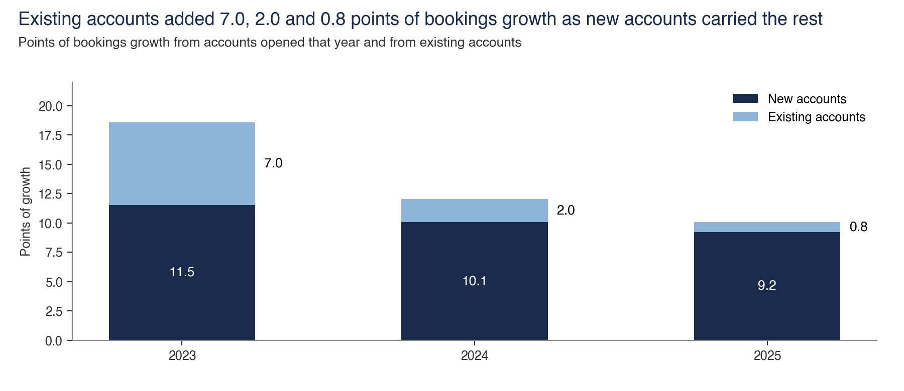

# Booked nights

**Booked nights = homes × open nights × conversion.** Filings give the total, and this folder splits it into guests, trips and stay length.

Back to the [walk through the equation](../README.md).

## Nights split into guests, trips and stay length

- **Sample.** Airbnb filings for nights and dated reviewer accounts for guests.
- **Interval.** Guests 17% to 26%, trips -1.9% to +5.3%, and stay length -2.9% to -4.2%.
- **Cannot establish.** The identity of new accounts. A new id can belong to a returning person.
- **Test against it.** The terms multiply to +18.9%, but the guest figure is modelled from reviews on surviving listings.
- **Files.** [nights_split.py](nights_split/nights_split.py), [account_identity.csv](nights_split/account_identity.csv), [terms.csv](nights_split/terms.csv)
