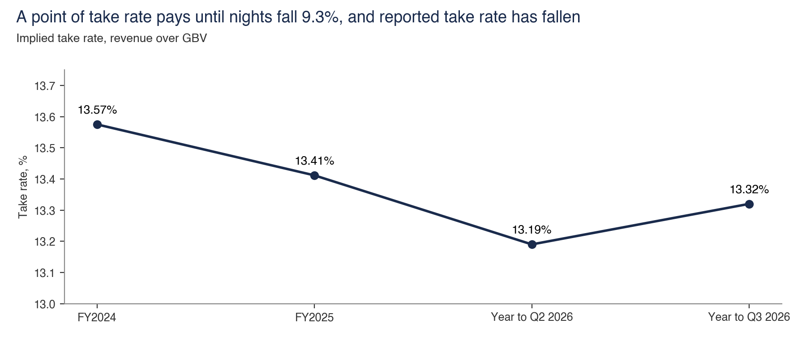
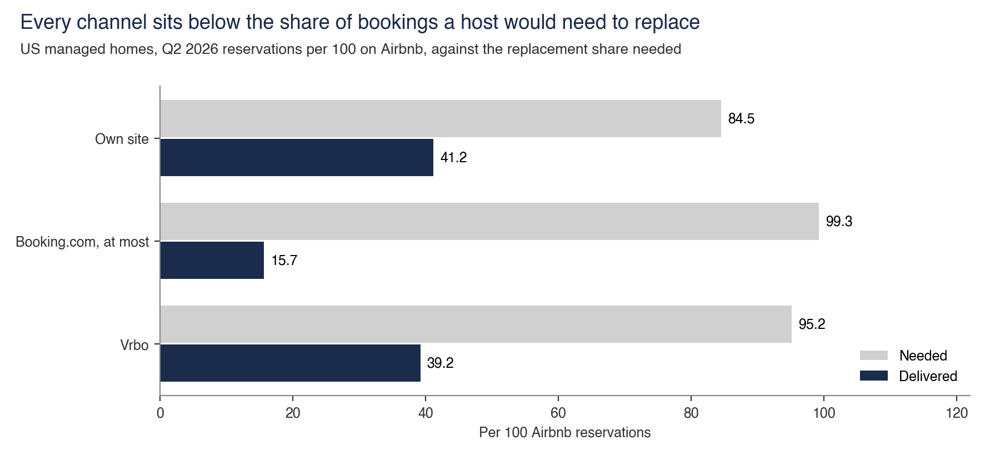
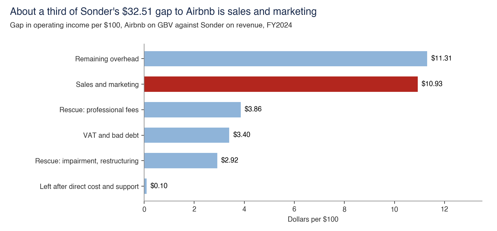

# Contribution per night

Contribution per night equals GBV per night times take rate less variable cost. It was $16.73 in FY2025, and the fee, price and property costs affect it.

Back to the [walk through the equation](../README.md).

## What a point of take rate is worth

- **Sample.** FY2025, year to Q2 2026 and year to Q3 2026 filings.
- **Interval.** 9.2% to 11.4% across periods and marketing treatments.
- **Cannot establish.** The cost of a fee increase. This is a break-even, and no file shows listing fee plans or measures demand response.
- **Test against it.** Take rate fell from 13.57% to 13.19% and stands at 13.32%. FY2024 also sits above the 13% to 13.5% range the note gives for the last two years.
- **Data note.** `filing_lines.csv` and `take_rate_grid.csv` hold the inputs. The note's 0.03% and 0.70% price responses have no output table.
- **Files.** [take_rate.py](take_rate/take_rate.py), [take_rate_grid.csv](take_rate/take_rate_grid.csv), [filing_lines.csv](../filing_lines.csv)

## Bookings a rival must replace

- **Sample.** A 4.1-night stay with $948 in host take, using KeyData Q2 2026 channel shares for US managed homes.
- **Interval.** Vrbo reads 90.2% at its earlier 8% fee. Review proxies range from 24.9 to 126.4 for Vrbo and 7.7 to 72.6 for Booking.com.
- **Cannot establish.** Recapture. Delivered figures measure income hosts already earn, so they do not show what a rival would win if a host left.
- **Test against it.** A second delivered measure excludes review counts. Revenue direct reads 67.4 and reached 100.0 in Q2 2025, before the single fee. Single-home hosts have no measure without review counts.
- **Files.** [replacement.py](replacement/replacement.py), [channel_shares.csv](replacement/channel_shares.csv), [replacement_test.csv](replacement/replacement_test.csv)

## Airbnb, Vacasa and Sonder per $100

- **Sample.** FY2024 10-Ks for Airbnb, Vacasa as manager and Sonder as lessee.
- **Interval.** Sonder ranges from $22.06 to $24.07 on estimated bookings, depending on tax rate.
- **Cannot establish.** That the rental model loses. Sonder's gap comprises 33.6% marketing, 34.8% overhead, 20.9% rescue cost and 10.4% VAT and bad debt, so one failed company supports about a third of the case.
- **Test against it.** Direct cost and support explain all but 0.3% of the gap in FY2024. The same line read -$0.62 for Sonder in FY2023.
- **Files.** [per_100.py](per_100/per_100.py), [gap_split.csv](per_100/gap_split.csv), [per100_lines.csv](per_100/per100_lines.csv)
