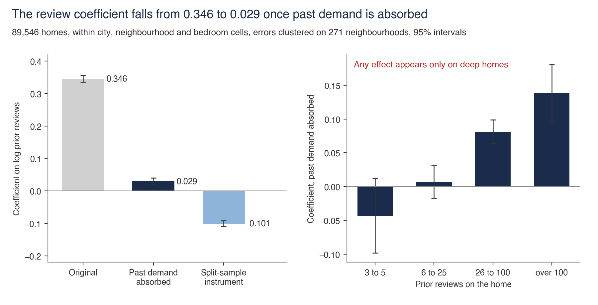
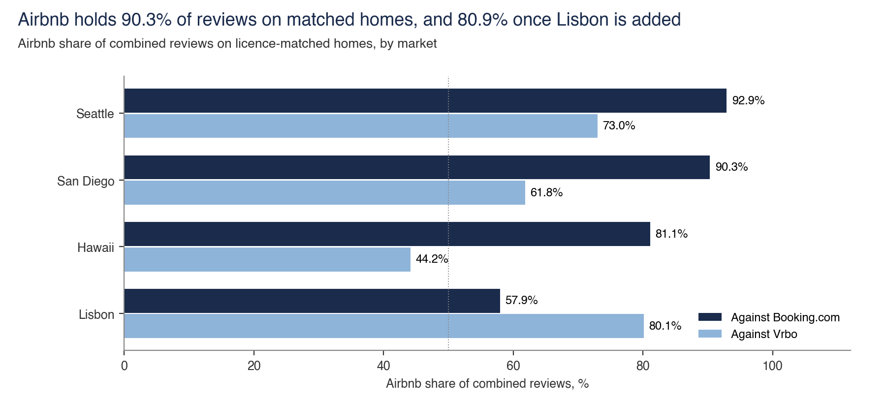
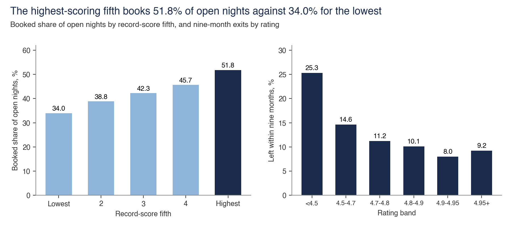
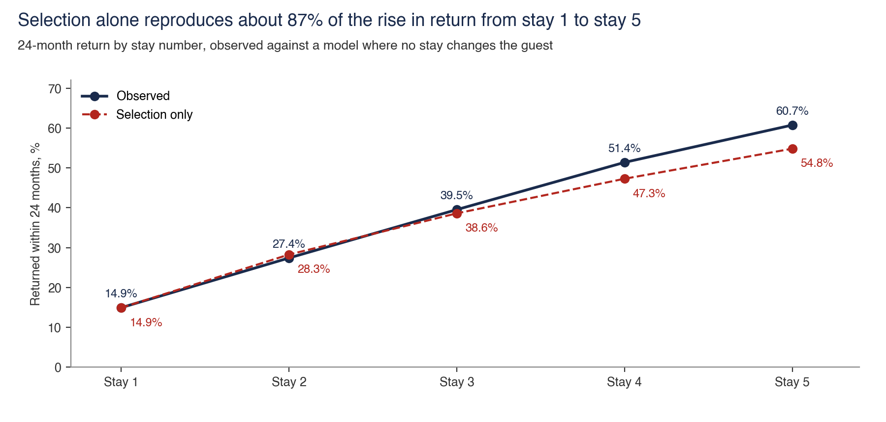
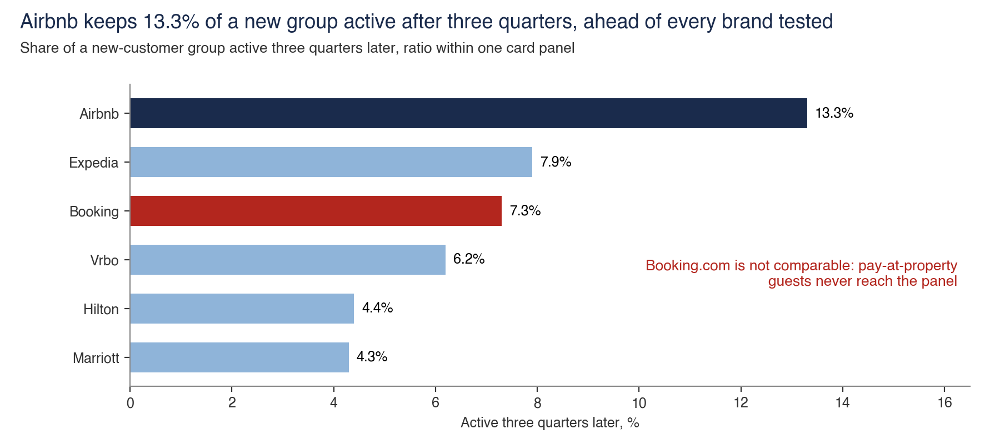
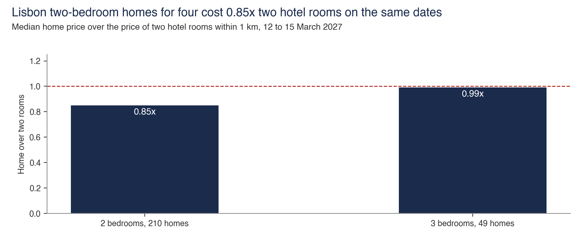
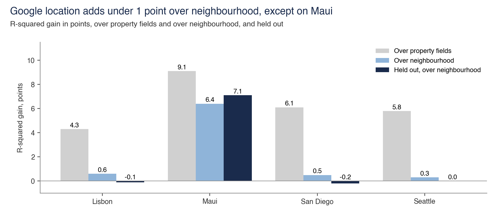

# Conversion

Conversion is the share of open nights that sell. Reviews, price against hotels and repeat guests move it.

Back to the [walk through the equation](../README.md).

## The review coefficient falls from 0.346 to 0.029

- **Sample.** 89,546 homes in ten cities, within 768 city, neighbourhood and bedroom cells, errors clustered on 271 neighbourhoods.
- **Interval.** 0.335 to 0.356 before, 0.019 to 0.040 after, -0.110 to -0.092 for the split-sample instrument.
- **Cannot establish.** That review depth causes bookings. Reviews stand in for past demand, and 2025 reviews sit on the path under test, so 0.029 is a low reading and the true figure is unproven.
- **Test against it.** **The failed test.** Absorbing 2025 reviews takes the coefficient from 0.346 to 0.029, the R-squared added by prior reviews from 0.152 to 0.0008, and the Booking.com gap from 2.1x to 1.07x. The instrument gives -0.101. By depth the absorbed coefficient is -0.043, 0.007, 0.081 and 0.139, so any effect sits on deep homes. On blocked nights 55% of the coefficient survives, in a fit explaining 18.7% of variation.
- **Data note.** `moments_*.csv` hold X'X and X'y by neighbourhood. They reproduce the coefficients, clustered errors, R-squared and Shapley shares of the home-level run exactly, with no home row published.
- **Files.** [review_effect.py](review_effect/review_effect.py), [moments_all_homes.csv](review_effect/moments_all_homes.csv), [moments_band_26_to_100.csv](review_effect/moments_band_26_to_100.csv), [moments_band_3_to_5.csv](review_effect/moments_band_3_to_5.csv), [moments_band_6_to_25.csv](review_effect/moments_band_6_to_25.csv), [moments_band_over_100.csv](review_effect/moments_band_over_100.csv), [moments_calendar.csv](review_effect/moments_calendar.csv)

## Airbnb holds 90.3% of reviews on matched homes

- **Sample.** 693 homes matched to Booking.com in three markets, 810 with Lisbon, and 748 matched to Vrbo.
- **Interval.** None.
- **Cannot establish.** A conversion edge. A review stock also reflects time on site and review habit.
- **Test against it.** Adding Lisbon takes 90.3% to 80.9%. The 65.8% in the same sentence of the note uses four markets, and on the same three it reads 74.6%. Vrbo reads 38.8% on that test. The Vrbo ahead share reruns at 69.9% against 68.9% printed.
- **Files.** [review_depth.py](review_depth/review_depth.py), [matched_home_sums.csv](review_depth/matched_home_sums.csv), [same_home_coldstart.csv](review_depth/same_home_coldstart.csv)

## Review content holds where review counts fail

- **Sample.** 89,546 homes for booked share, 133,164 listings for exit by rating, 137,653 for exit by depth, 54,820 for the price premium.
- **Interval.** None. These are census cuts.
- **Cannot establish.** That a score causes the outcome. Better homes can score higher and last longer for reasons of their own.
- **Test against it.** Exit comes from a snapshot pair, where 13% to 15% of reviews vanished across three cities. The months to 25 reviews rest on 57,720 surviving homes, so slow homes that left are missing.
- **Files.** [review_content.py](review_content/review_content.py), [conv_by_trust.csv](review_content/conv_by_trust.csv), [exit_by_depth.csv](review_content/exit_by_depth.csv), [exit_by_rating.csv](review_content/exit_by_rating.csv), [rebuild_months.csv](review_content/rebuild_months.csv), [same_host_depth.csv](review_content/same_host_depth.csv)

## Return by stay number is mostly selection

- **Sample.** 7.47m reviewed stays, 2019 to 2024, ten cities.
- **Interval.** Plus or minus 0.03 points at stay 1 and 0.47 at stay 5.
- **Cannot establish.** That each stay makes the next more likely. Frequent travellers stay more, and the remainder cannot be separated from review habit.
- **Test against it.** A selection-only model reproduces 87.1% of the rise, on cells rerun here. The free fit keeps 46.9% on stays and 73.3% on trips. Same-guest gaps fall 25.8% pooled and 15.6% for guests first seen from 2022, and an 18.5% rise in review habit gives the same fall. Reviews lost between snapshots cost up to about 6% of the ladder.
- **Data note.** `selection_cells.csv` has stay number by tenure cells. The rest are aggregate tables. No reviewer id is in the repo.
- **Files.** [stay_ladder.py](stay_ladder/stay_ladder.py), [repeat_paths.csv](stay_ladder/repeat_paths.csv), [same_guest_gaps.csv](stay_ladder/same_guest_gaps.csv), [selection_cells.csv](stay_ladder/selection_cells.csv), [stay_ladder_refit.csv](stay_ladder/stay_ladder_refit.csv), [stay_ladder_tests.csv](stay_ladder/stay_ladder_tests.csv)

## Return ratios within one card panel

- **Sample.** A licensed card panel, new-customer groups from July 2025 to July 2026.
- **Interval.** None. Attrition of 1.75% a year moves the 13.3% by about 1.3% of its value.
- **Cannot establish.** A level of any kind. These are ratios within one panel, so they say nothing on customers or dollars, and Airbnb discloses no series to check them against.
- **Test against it.** Bias direction on every reading, and attrition. Booking.com is not comparable, because pay-at-property guests never reach the panel. The note prints panel spend as dollars, so this folder holds the ratios alone.
- **Data note.** Ratios only. Customer counts, spend levels and panel rows stay out.
- **Files.** [card_panel.py](card_panel/card_panel.py), [card_older_group.csv](card_panel/card_older_group.csv), [card_ratios.csv](card_panel/card_ratios.csv), [matched_group_shares.csv](card_panel/matched_group_shares.csv), [spend_ratio_vrbo.csv](card_panel/spend_ratio_vrbo.csv)

## Lisbon homes against hotel rooms

- **Sample.** 273 Lisbon homes, 12 to 15 March 2027 offers, against hotels within 1 km.
- **Interval.** None.
- **Cannot establish.** A market-wide price edge. One city, one set of dates, and offers read in November 2026.
- **Test against it.** Against the cheapest quarter of nearby hotels all homes read 1.08x, with 39% cheaper. The 0.66x assumes two guests a room and a home price unchanged for six.
- **Data note.** Ratios by bedroom count. No offer price is in the repo. The larger-home and price-per-guest figures in the note have no output table, and the ledger marks them.
- **Files.** [hotel_price.py](hotel_price/hotel_price.py), [lisbon_cheapest_quarter.csv](hotel_price/lisbon_cheapest_quarter.csv), [lisbon_ratio_all.csv](hotel_price/lisbon_ratio_all.csv), [lisbon_ratio_by_bedrooms.csv](hotel_price/lisbon_ratio_by_bedrooms.csv)

## The Google layer

- **Sample.** 777 cells of 1 km, 4,662 Places Aggregate counts logged, with 4,844 requests and 196 errors on the console. The 1 km Routes layer is 1,554 elements, and the Routes account spent 8,890 of 10,000 free elements once a lost run and a rerun at 500 m are counted.
- **Interval.** Intervals on each gain are in `gmp_cells.csv`.
- **Cannot establish.** Anything before November 2026. Places data is current, so it cannot date a hotel or a home back to 2022.
- **Test against it.** R-squared gain over property fields, over neighbourhood and held out. Over neighbourhood the gain is 0.3 to 0.6 points outside Maui, and held out it is -0.2 to 0.0 outside Maui. Hotel shares hold as an order of markets, and OpenStreetMap gives higher levels.
- **Data note.** Market summaries only. **Google cell counts stay out under Google's terms, so this script cannot rerun the regressions.** It rebuilds the call totals and reads the gains.
- **Files.** [location.py](location/location.py), [gmp_cells.csv](location/gmp_cells.csv)
