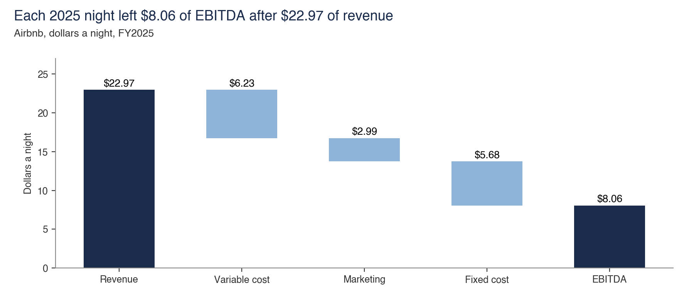
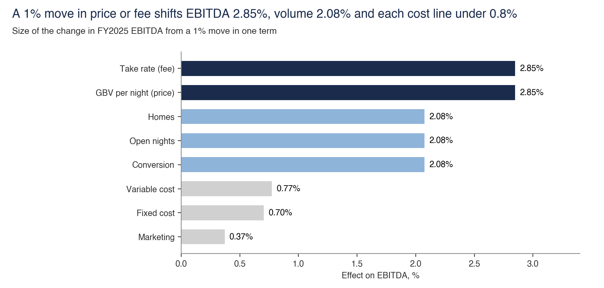
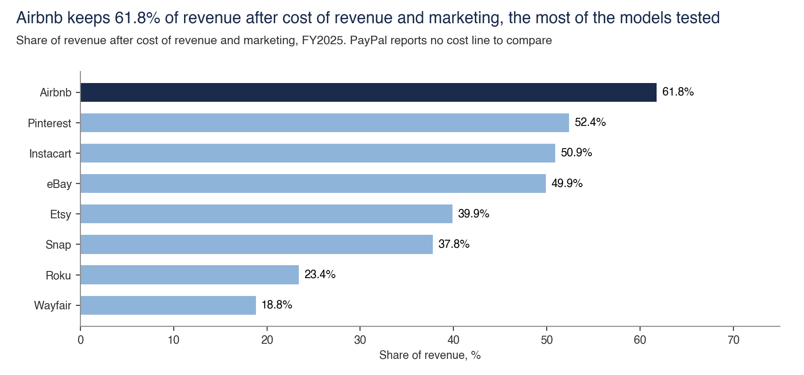
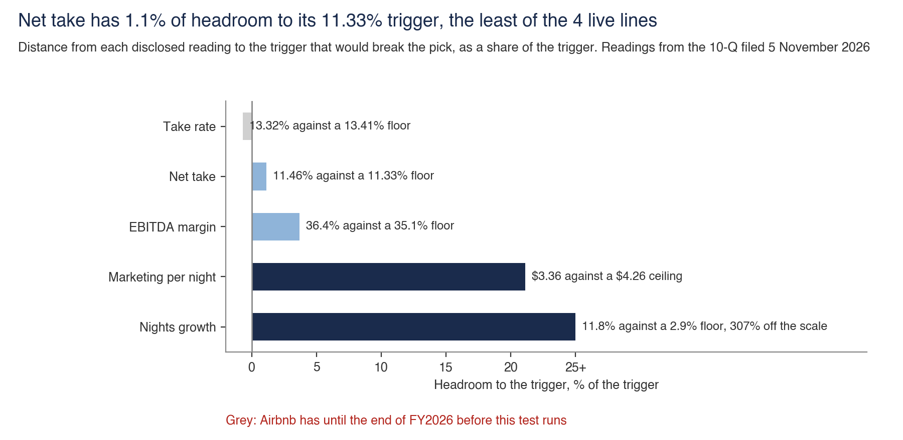

# EBITDA

**EBITDA = booked nights × contribution per night − marketing − fixed cost.** This folder contains the equation, term ranking and peer frame.

Back to the [walk through the equation](../README.md).

## The equation, rebuilt from filed lines

- **Sample.** Airbnb 10-K lines, FY2022 to FY2025.
- **Interval.** None. The equation is an identity.
- **Cannot establish.** That terms are independent. Fixed cost closes the equation, and Adjusted EBITDA excludes stock pay.
- **Test against it.** The identity closes to zero. Bridge terms of +$1,027m, +$870m, +$30m, -$201m and -$333m sum to $1,394m. The note rounds per-night values first, showing +$866m, +$32m, -$197m and -$336m, which sum to $1,392m.
- **Files.** [equation.py](equation/equation.py), [filing_lines.csv](../filing_lines.csv)

## A 1% move in each term

- **Sample.** FY2025 filed lines and the year to Q3 2026 sensitivity grid.
- **Interval.** None. This is a derivative of the identity.
- **Cannot establish.** Which term will move. Elasticity does not predict the change, and the nights sensitivity holds marketing dollars fixed.
- **Test against it.** With 2% payment cost on GBV, GBV per night reads 2.42%. With marketing per night fixed, nights read 1.70%. The year to Q3 2026 ranking is 2.75%, 2.03%, 0.72%, 0.64% and 0.38%.
- **Files.** [ranking.py](ranking/ranking.py), [sensitivity_grid.csv](ranking/sensitivity_grid.csv), [filing_lines.csv](../filing_lines.csv)

## Nine models on one frame

- **Sample.** 153 company-years across 51 Compustat tickers, including nine case companies.
- **Interval.** None.
- **Cannot establish.** The note's "most promising outlook", which is a judgement. Models use different volume units, and 5 of 9 tie volume to revenue as transacted value.
- **Test against it.** The test flags year-on-year margin swings above 5 points and checks whether volume rebuilds reported revenue.
- **Data note.** Ratios only. Compustat line items stay out, so counts rebuild from `nine_frame_ratios.csv` and `nine_growth.csv`.
- **Files.** [nine_models.py](nine_models/nine_models.py), [nine_frame_ratios.csv](nine_models/nine_frame_ratios.csv), [nine_growth.csv](nine_models/nine_growth.csv)

## The five disclosed lines that would break the pick

- **Sample.** Net take, TTM implied take rate, brand and performance marketing per night, Nights and Seats Booked growth, and TTM Adjusted EBITDA margin from the 10-Q filed 5 November 2026.
- **Interval.** None. Filed figures are measured against triggers set on 6 November 2026.
- **Cannot establish.** That the triggers are correctly set. They use the author's arithmetic, and the nights trigger assumes GBV per night rises 6.2% again.
- **Test against it.** The script fails when a live line crosses its trigger. Net take has 1.15% headroom to its 11.33% floor, the nearest of the four live lines. Take rate is already 13.32%, below its 13.41% floor, but that test starts at the end of FY2026 and stays grey until then.
- **Data note.** `watch_lines.csv` holds each reading, trigger, failure side, start date and filing. Update it when a 10-Q lands.
- **Files.** [watch.py](watch/watch.py), [watch_lines.csv](watch/watch_lines.csv)
