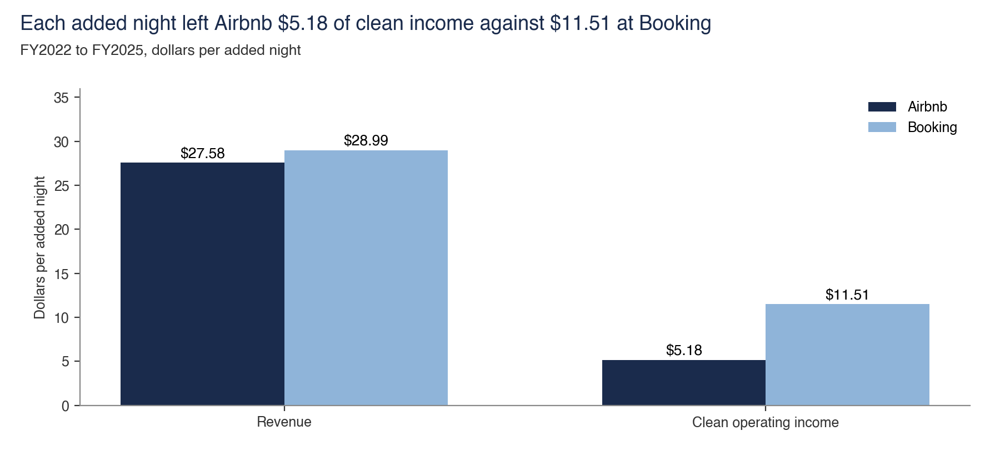

# Fixed cost

Fixed cost is the $3,026m left after variable cost, marketing and EBITDA. Added nights spread it.

Back to the [walk through the equation](../README.md).

## What each added night kept

- **Sample.** FY2022 to FY2025 and H1 2026 filings for Airbnb and Booking.
- **Interval.** None.
- **Cannot establish.** An edge over Booking on added nights. Booking earned $11.51 of clean income against Airbnb's $5.18, and revenue after marketing per $100 of added bookings is level at $11.68 and $11.77.
- **Test against it.** Marketing per added night rose from $4.06 to $9.89 in H1 2026, and added revenue kept fell from 63% to 49%. FY2022 is a recovery base. The 4.4-point surplus rests on management's estimate of unpaid traffic.
- **Files.** [added_nights.py](added_nights/added_nights.py), [filing_lines.csv](../filing_lines.csv)
