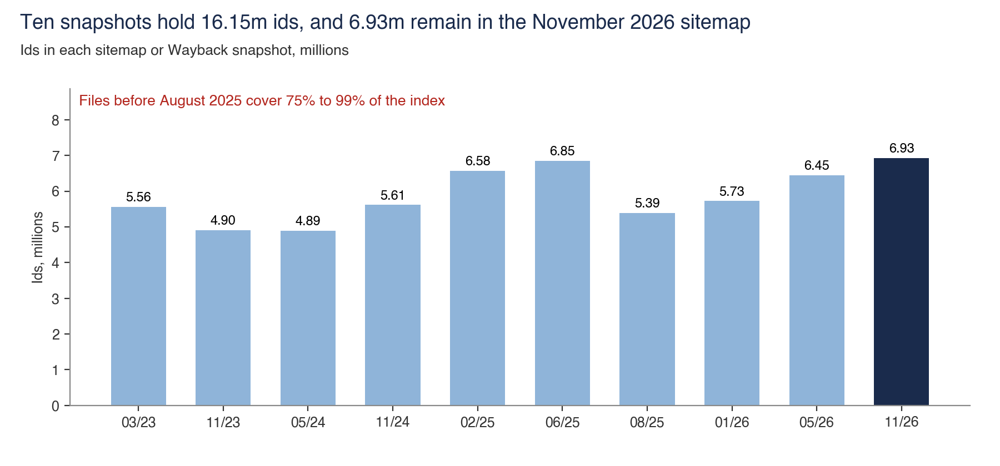
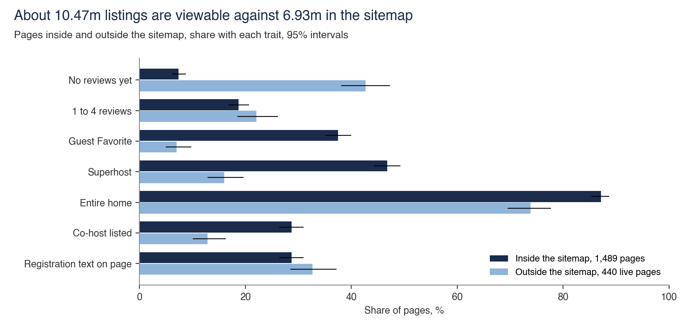
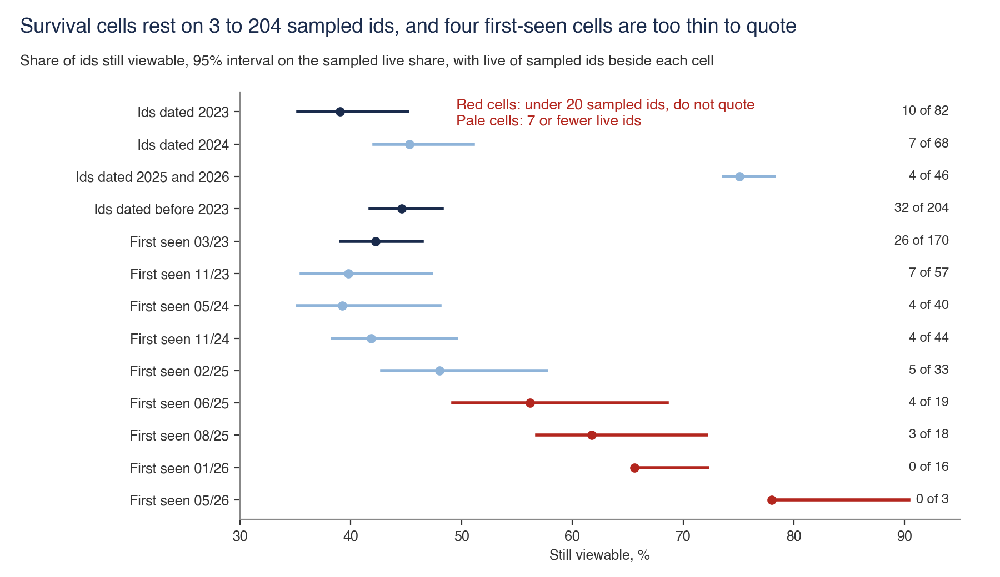
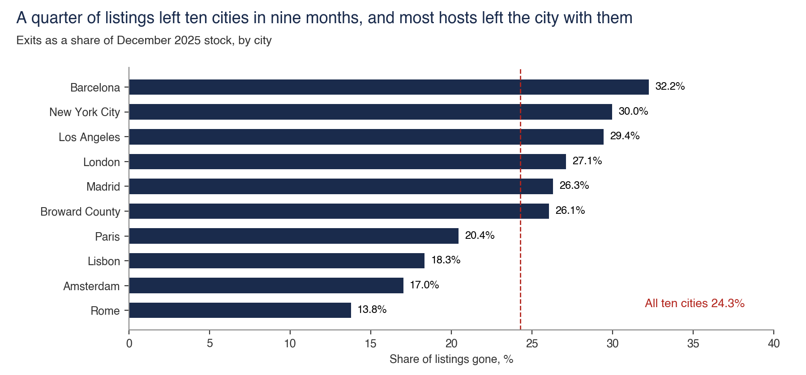
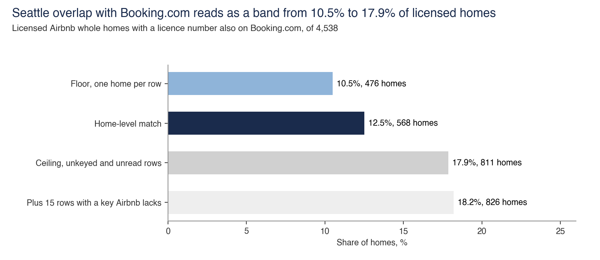
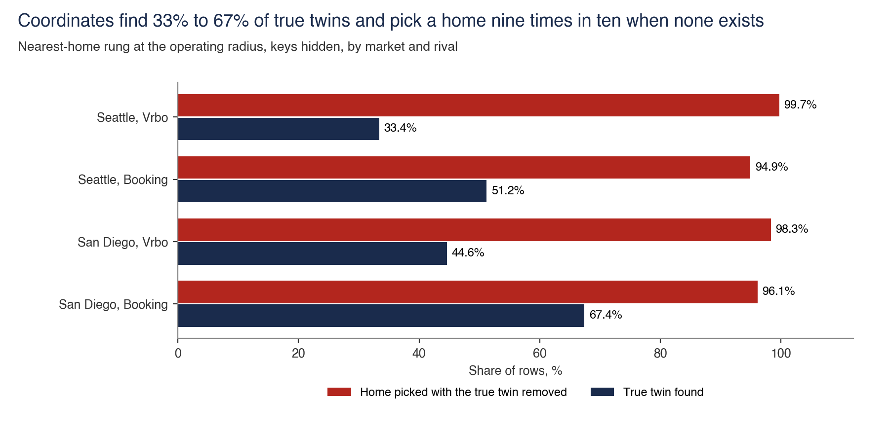
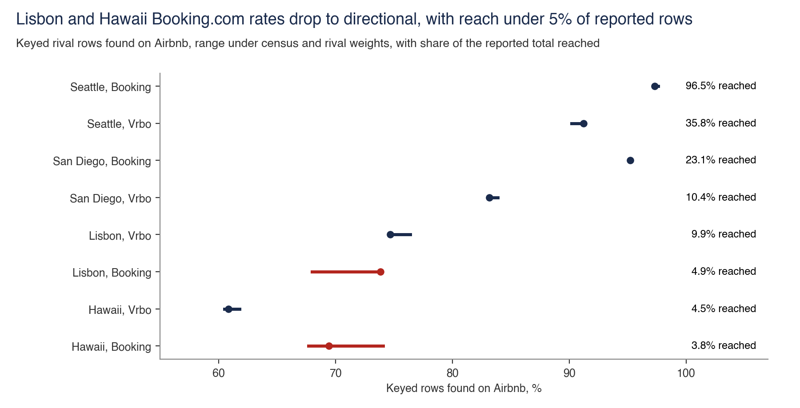
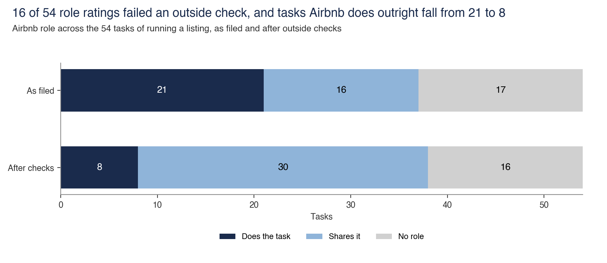
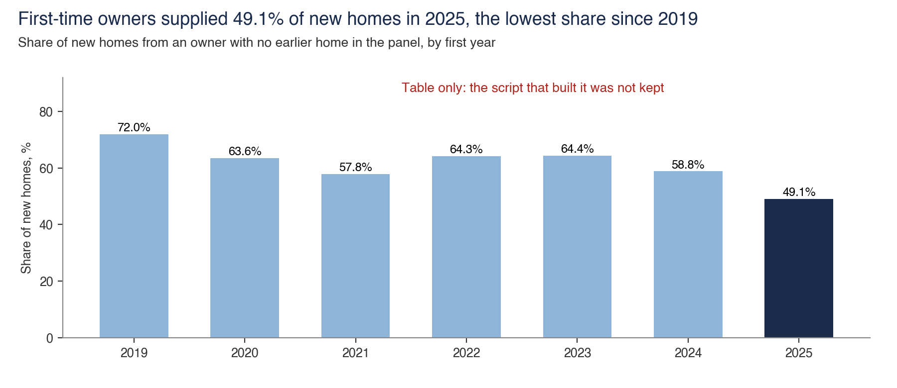

# Homes

Homes are the listings hosts fund and keep on Airbnb. Host effort, protection, regulation and rival sites move the count.

Back to the [walk through the equation](../README.md).

## 16,150,130 listing ids from ten snapshots

- **Sample.** Ten sitemap and Wayback snapshots from March 2023 to November 2026, 61.7m rows read before de-duplication.
- **Interval.** None. These are counts of files read in full.
- **Cannot establish.** How many listings were ever bookable. Ids that never reached a sitemap are unseen, and an id in a sitemap says nothing on bookings.
- **Test against it.** A recount of the union and each snapshot from the presence table, and the census join, which places 65.3% of 1,710,831 census listings in the November sitemap. Files before August 2025 cover 75% to 99% of the index, so early levels are not comparable. Inclusion falls from 87% at month 11 to 57% at month 13, which points to a 12-month rule that Airbnb has not published.
- **Data note.** `presence_patterns.csv` has one row per pattern across the ten snapshots. No listing id is in the repo.
- **Files.** [frame.py](frame/frame.py), [cliff.csv](frame/cliff.csv), [presence_patterns.csv](frame/presence_patterns.csv), [steady_inclusion.csv](frame/steady_inclusion.csv)

## About 10.47m viewable listings

- **Sample.** 1,710,831 census listings, 499 fetched ids outside the sitemap, 1,489 fetched pages inside it.
- **Interval.** 10.34m to 10.60m for the stock, 85.0% to 90.7% for the live share outside the sitemap.
- **Cannot establish.** The true stock. The interval covers sampling alone, and the census under-represents listings that never sell, so the figure more likely sits above it.
- **Test against it.** The unweighted build reruns here at 10.19m. The region weights that lift it to 10.47m are carried as an input, since they rest on census rows.
- **Files.** [viewable.py](viewable/viewable.py), [frame_profile.csv](viewable/frame_profile.csv), [universe_size.csv](viewable/universe_size.csv)

## Survival by vintage, from 400 sampled ids

- **Sample.** 400 ids drawn from the 9.22m ids absent in November 2026. Each cell applies its live share to its absent ids, and ids still in the sitemap count in full.
- **Interval.** Wilson intervals on each live share, 83.1% to 89.7% for withdrawn pages, 7.66m to 8.27m for ids no longer viewable.
- **Cannot establish.** That a host quit. A 410 covers deletion and unlisting, and a host can relist, so the only reading is "no longer viewable".
- **Test against it.** The status of each sampled page. **Four first-seen cells rest on under 20 sampled ids and are dropped.** Cells with 7 or fewer live ids are thin, and their intervals look narrow because ids still in the sitemap count in full. Collection hit 2 rate-limit responses and 30 seconds of a second worker, and duplicates were removed.
- **Data note.** `sampled_ids.csv` keeps the 400 rows with the id removed. `survival_cells.csv` is written by the script.
- **Files.** [survival.py](survival/survival.py), [ids_by_first_snapshot.csv](survival/ids_by_first_snapshot.csv), [ids_by_year_group.csv](survival/ids_by_year_group.csv), [sampled_ids.csv](survival/sampled_ids.csv), [survival_cells.csv](survival/survival_cells.csv)

## A quarter of listings left ten cities in nine months

- **Sample.** 392,070 listings in ten cities, December 2025 to September 2026.
- **Interval.** None. These are census counts for those cities.
- **Cannot establish.** Where leavers went. The data cannot separate a host who quit from one who moved, and ten large cities stand in for a global rate.
- **Test against it.** Hosts with no listing left in the city, replacement by same host, room type and bedrooms, and prior-year reviews among leavers.
- **Files.** [exits.py](exits/exits.py), [ten_city_exits.csv](exits/ten_city_exits.csv)

## Seattle overlap with Booking.com, 10.5% to 18.2%

- **Sample.** 4,538 licensed Airbnb whole homes under 30 nights in the September 2026 Inside Airbnb file, against 773 of 801 Booking.com rows pulled on 5 November 2026.
- **Interval.** Bounds of 10.5% to 17.9% from identification, or 18.2% with the 15 keyed misses. Wilson intervals on the host-size groups.
- **Cannot establish.** Exclusivity. Only Booking.com is tested at census depth, and own sites, unread Vrbo rows and other channels sit outside it.
- **Test against it.** Only licence-key matches count, because with keys hidden the coordinate rung found the right home for 51.2% of 508 known Seattle Booking.com pairs and still picked a home for 89.4% of rows whose true twin had been removed. The 200 hand checks planned in the study were never done, so no human false-match rate exists. The 17.9% ceiling counts every unkeyed and unread row. A further 15 rows carry a licence absent from the Airbnb file, which is keyed evidence against a match, and counting them too gives the 18.2% printed in the footnote of the note. See [claim.md](overlap/claim.md) for the printed claim and the readings it must never carry.
- **Data note.** `seattle_home_cells.csv` has host size by open days by match. `seattle_booking_rows.csv` is the row ledger. `both_rivals_cells.csv` holds both-rival counts. No licence number or rival row is in the repo.
- **Files.** [overlap.py](overlap/overlap.py), [both_rivals_cells.csv](overlap/both_rivals_cells.csv), [seattle_booking_rows.csv](overlap/seattle_booking_rows.csv), [seattle_home_cells.csv](overlap/seattle_home_cells.csv)

## Hidden-key test of the match ladder

- **Sample.** 1,382 known pairs in San Diego and Seattle, on Booking.com and Vrbo, across three radii.
- **Interval.** Wilson intervals on every rung are in `match_ladder.csv`.
- **Cannot establish.** The false-match rate of the licence key itself. The test measures the rungs below the key, and it covers two markets.
- **Test against it.** Keys were hidden on known pairs, then the true twin was removed as a placebo. The nearest-home rung recovers 33.4% to 67.4% and picks a home for 85.8% to 99.7% of rows with no twin. Adding bedrooms recovers 49.3% to 70.2% and still picks for 62.2% to 90.8%. The unique rungs pick less often and recover 8.3% to 27.4%. All stay uncounted.
- **Files.** [match_ladder.py](match_ladder/match_ladder.py), [match_ladder.csv](match_ladder/match_ladder.csv)

## Coverage of the 385-record design

- **Sample.** Eight market and rival cells, with reported totals read from the rival run logs.
- **Interval.** None, because inclusion probabilities are unknown. The range shows how far census and rival weights move each rate.
- **Cannot establish.** A rate for the market. Six rates hold as read, and Lisbon and Hawaii on Booking.com drop to directional.
- **Test against it.** Reach against the reported total, the share of rows in the densest census decile against the census share, and reweighting. Lisbon Booking.com is the least representative cell: 70 rows resolved to Brazil and Croatia, and searches reach 38.3% of the total.
- **Files.** [sampling.py](sampling/sampling.py), [sampling_audit.csv](sampling/sampling_audit.csv)

## The 54-task map, 16 role ratings failed

- **Sample.** 54 tasks in running a listing, coded by the author, each checked against a vendor page, filing or host forum.
- **Interval.** None. This is a coding exercise.
- **Cannot establish.** How much host work Airbnb removes. Tasks count equally whatever their share of hours, and no file holds hours.
- **Test against it.** An outside check on every rating. 38 role ratings survive and 16 fail: 8 on fact, 6 on definition and 2 coded against Airbnb. Tasks done outright fall from 21 to 8, or 13 if running the system counts. On automation 48 survive, 2 fail and 4 have no usable check. A second coder scored tasks 31 to 54 only and disputed automation on 4 tasks, and that verdict sits in the last column of the table.
- **Files.** [task_map.py](task_map/task_map.py), [task_map_audit.csv](task_map/task_map_audit.csv)

## First-time owners, 49.1% of new homes in 2025

- **Sample.** 46,733 homes first seen in 2025.
- **Interval.** None.
- **Cannot establish.** Its own build. The script that made this table was not kept, so its panel and its first-owner test cannot be re-derived.
- **Test against it.** None could be run. The figure stays in the ledger as weakened until the table is rebuilt.
- **Files.** [new_owners.py](new_owners/new_owners.py), [new_home_owner.csv](new_owners/new_home_owner.csv)
