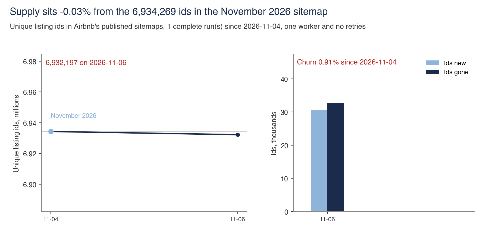

# Homes

Homes are listings hosts fund and keep on Airbnb. Host effort, protection, regulation and rival sites affect supply.

Back to the [walk through the equation](../README.md).

## 16,150,130 listing ids from ten snapshots

- **Sample.** Ten sitemap and Wayback snapshots from March 2023 to November 2026, covering 61.7m rows before de-duplication.
- **Interval.** None. These are full-file counts.
- **Cannot establish.** The number of listings ever bookable. Ids absent from sitemaps are unseen, and sitemap presence says nothing about bookings.
- **Test against it.** Recounts use the presence table and census join. The November sitemap contains 65.3% of 1,710,831 census listings. Files before August 2025 cover 75% to 99% of the index, making early levels incomparable. Inclusion falls from 87% at month 11 to 57% at month 13, suggesting an unpublished 12-month rule.
- **Data note.** `presence_patterns.csv` has one row per pattern across ten snapshots. Listing ids are excluded.
- **Files.** [frame.py](frame/frame.py), [cliff.csv](frame/cliff.csv), [presence_patterns.csv](frame/presence_patterns.csv), [steady_inclusion.csv](frame/steady_inclusion.csv)

## About 10.47m viewable listings

- **Sample.** 1,710,831 census listings, 499 fetched ids outside the sitemap and 1,489 fetched pages inside it.
- **Interval.** Stock ranges from 10.34m to 10.60m. The live share outside the sitemap ranges from 85.0% to 90.7%.
- **Cannot establish.** The true stock. The interval covers sampling only, and the census under-represents listings that never sell, so the figure likely sits higher.
- **Test against it.** The unweighted build reruns at 10.19m. Region weights raise it to 10.47m and remain an input because they rely on census rows.
- **Files.** [viewable.py](viewable/viewable.py), [frame_profile.csv](viewable/frame_profile.csv), [universe_size.csv](viewable/universe_size.csv)

## Survival by vintage, from 400 sampled ids

- **Sample.** 400 ids drawn from the 9.22m absent in November 2026. Live shares apply to absent ids, while ids still in the sitemap count in full.
- **Interval.** Wilson intervals on live shares. Withdrawn pages range from 83.1% to 89.7%, and 7.66m to 8.27m ids are no longer viewable.
- **Cannot establish.** Host departures. A 410 response covers deletion and unlisting, and hosts can relist. The measure is therefore limited to pages no longer viewable.
- **Test against it.** Every sampled page has a status check. Four first-seen cells with fewer than 20 sampled ids are dropped. Cells with 7 or fewer live ids are thin, and intervals look narrow because sitemap ids count in full. Collection returned 2 rate-limit responses and used 30 seconds of a second worker. Duplicates were removed.
- **Data note.** `sampled_ids.csv` holds 400 rows with ids removed. The script writes `survival_cells.csv`.
- **Files.** [survival.py](survival/survival.py), [ids_by_first_snapshot.csv](survival/ids_by_first_snapshot.csv), [ids_by_year_group.csv](survival/ids_by_year_group.csv), [sampled_ids.csv](survival/sampled_ids.csv), [survival_cells.csv](survival/survival_cells.csv)

## A quarter of listings left ten cities in nine months

- **Sample.** 392,070 listings across ten cities, December 2025 to September 2026.
- **Interval.** None. These are city census counts.
- **Cannot establish.** The destination of leavers. The data cannot separate hosts who quit from those who moved, and ten large cities represent the global rate.
- **Test against it.** Tests cover hosts with no remaining city listings, same-host replacement, room type, bedrooms and prior-year reviews among leavers.
- **Files.** [exits.py](exits/exits.py), [ten_city_exits.csv](exits/ten_city_exits.csv)

## Seattle overlap with Booking.com, 10.5% to 18.2%

- **Sample.** 4,538 licensed Airbnb whole homes under 30 nights in the September 2026 Inside Airbnb file, against 773 of 801 Booking.com rows pulled on 5 November 2026.
- **Interval.** Identification bounds are 10.5% to 17.9%, or 18.2% with 15 keyed misses. Host-size groups use Wilson intervals.
- **Cannot establish.** Exclusivity across channels. Only Booking.com is tested at census depth. Own sites, unread Vrbo rows and other channels remain outside the test.
- **Test against it.** Only licence-key matches count. With keys hidden, the coordinate rung found 51.2% of 508 known Seattle Booking.com pairs and selected a home for 89.4% of rows whose true twin was removed. The planned 200 hand checks never happened, so no human false-match rate exists. The 17.9% ceiling counts every unkeyed and unread row. Another 15 rows have licences absent from the Airbnb file, and counting them gives the 18.2% in the note's footnote. [claim.md](overlap/claim.md) records the printed claim and its limits.
- **Data note.** `seattle_home_cells.csv` holds host size, open days and match status. `seattle_booking_rows.csv` is the row ledger. `both_rivals_cells.csv` holds both-rival counts. Licence numbers and rival rows are excluded.
- **Files.** [overlap.py](overlap/overlap.py), [both_rivals_cells.csv](overlap/both_rivals_cells.csv), [seattle_booking_rows.csv](overlap/seattle_booking_rows.csv), [seattle_home_cells.csv](overlap/seattle_home_cells.csv)

## Hidden-key test of the match ladder

- **Sample.** 1,382 known pairs in San Diego and Seattle, across Booking.com and Vrbo and three radii.
- **Interval.** Wilson intervals for every rung are in `match_ladder.csv`.
- **Cannot establish.** The false-match rate of the licence key. The test covers lower rungs in two markets.
- **Test against it.** Keys were hidden on known pairs, then true twins were removed as a placebo. The nearest-home rung recovered 33.4% to 67.4% and selected homes for 85.8% to 99.7% of rows with no twin. Adding bedrooms recovered 49.3% to 70.2% and selected homes for 62.2% to 90.8%. Unique rungs recovered 8.3% to 27.4% and all remain uncounted.
- **Files.** [match_ladder.py](match_ladder/match_ladder.py), [match_ladder.csv](match_ladder/match_ladder.csv)

## Coverage of the 385-record design

- **Sample.** Eight market and rival cells, using reported totals from rival run logs.
- **Interval.** None, because inclusion probabilities are unknown. The range shows how census and rival weights change each rate.
- **Cannot establish.** A market-wide rate. Six rates hold as read, while Lisbon and Hawaii on Booking.com are directional.
- **Test against it.** Tests compare reach with reported totals, the densest census decile with its census share, and weighted rates. Lisbon Booking.com is the least representative cell, with 70 rows resolved to Brazil and Croatia and searches reaching 38.3% of the total.
- **Files.** [sampling.py](sampling/sampling.py), [sampling_audit.csv](sampling/sampling_audit.csv)

## The 54-task map, 16 role ratings failed

- **Sample.** 54 listing-management tasks coded by the author and checked against vendor pages, filings or host forums.
- **Interval.** None. This is a coding exercise.
- **Cannot establish.** The amount of host work Airbnb removes. Tasks count equally regardless of hours, and no file records hours.
- **Test against it.** Every rating received an outside check. Of 54 role ratings, 38 survived and 16 failed. The failures cover 8 factual issues, 6 definition issues and 2 ratings coded against Airbnb. Tasks done outright fell from 21 to 8, or 13 when running the system counts. Automation had 48 surviving ratings, 2 failures and 4 without usable checks. A second coder scored tasks 31 to 54 and disputed automation on 4 tasks. That verdict appears in the table's last column.
- **Files.** [task_map.py](task_map/task_map.py), [task_map_audit.csv](task_map/task_map_audit.csv)

## First-time owners, 49.1% of new homes in 2025

- **Sample.** 46,733 homes first seen in 2025.
- **Interval.** None.
- **Cannot establish.** The figure's own construction. Its original script was not kept, so the panel and first-owner test cannot be reproduced.
- **Test against it.** No test could be rerun. The ledger keeps the figure as weakened until the table is rebuilt.
- **Files.** [new_owners.py](new_owners/new_owners.py), [new_home_owner.csv](new_owners/new_home_owner.csv)

## Supply tracked every week

- **Sample.** Airbnb's published sitemap index and listing-url files, read in full every Friday. The 6 November 2026 run read 139 files and found 6,932,197 unique ids.
- **Interval.** None. These are full-file id counts.
- **Cannot establish.** Bookable supply. Sitemap entries say nothing about whether a home is live or sells. The sitemap contains 6.93m of about 10.47m viewable listings.
- **Test against it.** One worker, a nine-second gap and no retries mean the first 429 or challenge page stops the run. Stopped runs stay out of the series. The study fails if the count moves more than 5% from 6,934,269 in the November 2026 sitemap, churn exceeds 10%, the run raises its layout flag, or the last run is over 10 days old. The first reading covers 4 to 6 November, with 30,538 new ids, 32,610 gone and 0.91% churn.
- **Data note.** `weekly_counts.csv` has one row per run with counts, churn and stop reason. Listing ids are excluded.
- **Files.** [weekly.py](weekly/weekly.py), [weekly_counts.csv](weekly/weekly_counts.csv), [weekly_sitemap.py](../archive/weekly_sitemap.py)
