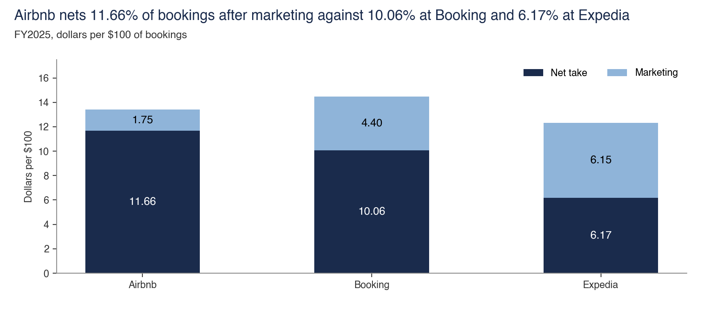

# Marketing

Marketing is $1,595m of brand and performance spend. Direct traffic and repeat guests affect the spend required.

Back to the [walk through the equation](../README.md).

## Net take and marketing per $100

- **Sample.** FY2025 filings for Airbnb, Booking and Expedia, Semrush web-visit estimates, and 76 hand-coded Meta ads for Airbnb and Vrbo.
- **Interval.** None.
- **Cannot establish.** That demand is owned. Search share excludes app traffic, and the note uses two Airbnb marketing figures, $1.75 and $2.63, on different definitions.
- **Test against it.** Booking's FY2025 net take rose while Airbnb's fell, narrowing the lead from 1.86 to 1.60 points.
- **Files.** [net_take.py](net_take/net_take.py), [ads_hand_coded.csv](net_take/ads_hand_coded.csv), [later_spend_per_100.csv](net_take/later_spend_per_100.csv), [search_share.csv](net_take/search_share.csv), [filing_lines.csv](../filing_lines.csv)
