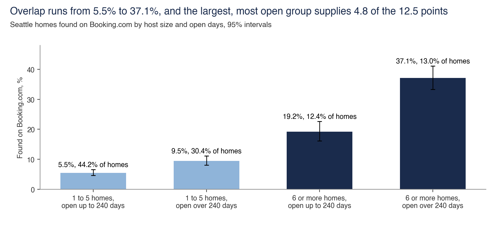
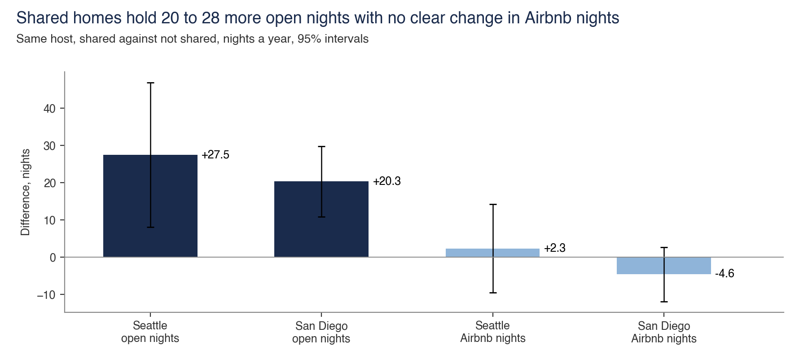

# Open nights

Open nights are the days a home offers for sale. Host size and a second site affect availability.

Back to the [walk through the equation](../README.md).

## The 12.5% as a sum over host size and open days

- **Sample.** 4,538 Seattle homes. Open days are unbooked nights over the next 365 days in the September 2026 file.
- **Interval.** The four groups range from 4.6% to 6.6%, 8.1% to 11.1%, 16.2% to 22.7% and 33.3% to 41.1%.
- **Cannot establish.** That calendars cause sharing. Homes listed on two sites can have more open days for that reason alone.
- **Test against it.** The four groups sum to 12.5%, and the largest, most open group contributes 4.8 points. Group floors are in the results file.
- **Files.** [calendar_split.py](calendar/calendar_split.py), [seattle_home_cells.csv](../homes/overlap/seattle_home_cells.csv)

## Shared homes add open nights under the same host

- **Sample.** 65 Seattle hosts with 871 homes and 119 San Diego hosts with 1,982 homes. Each host has shared and unshared homes.
- **Interval.** Open nights range from 8.1 to 46.9 in Seattle and 10.8 to 29.8 in San Diego. Airbnb nights range from -9.6 to 14.2 and -11.9 to 2.6.
- **Cannot establish.** Displacement. Airbnb nights are review-based estimates, and the sample includes hosts who chose to share some homes.
- **Test against it.** Host fixed effects control for bedrooms and capacity, with errors clustered by host. Airbnb nights move +2.3 (p=0.71) in Seattle and -4.6 (p=0.21) in San Diego.
- **Data note.** `host_moments.csv` holds anonymised per-host sums of squares and cross-products, enough to reproduce the slope and clustered errors without home rows.
- **Files.** [same_host.py](same_host/same_host.py), [host_moments.csv](same_host/host_moments.csv)
